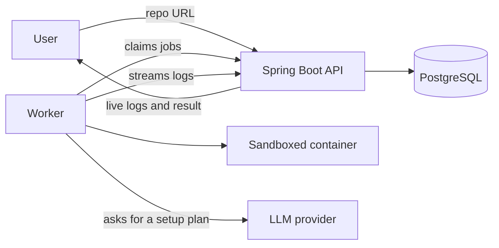

# README Runner

Paste a public GitHub repo, and README Runner tries to get it running in a safe sandbox, then tells you exactly what worked and what didn't.

> **Status: planning.** There's no working code yet. Everything below describes what's being built. Follow the progress in the [build plan](docs/BUILD_PLAN.md).

Demo: coming with the first working version.

## Why

Most README setup instructions are written for people who already know the tools, and many quietly go out of date. Non-technical people get stuck at step one, and maintainers rarely find out their setup steps are broken.

## How it will work

1. The API checks the repo URL and queues a run in PostgreSQL.
2. A worker on a separate machine claims the run and clones the repo into a throwaway sandbox.
3. An LLM reads the README and proposes setup steps as structured data.
4. The steps run inside the sandbox with strict CPU, memory, time and network limits.
5. Logs stream back live, and the run ends with a clear result: it worked, or the exact step that failed and why.

The AI only suggests steps. The hard part is the backend: running untrusted code safely, and keeping jobs reliable when things go wrong.

## Tech stack (planned)

- **Backend:** Java, Spring Boot, PostgreSQL, Flyway
- **Sandbox:** Docker with gVisor
- **Cloud:** AWS, managed with Terraform
- **Testing:** JUnit, Testcontainers
- **CI:** GitHub Actions

The reasons behind each choice are in the [build plan](docs/BUILD_PLAN.md#stack-decisions).

## Run it locally

Not available yet. Setup steps will be added with the first milestone.

## Limitations

Planned for the first version:

- Public GitHub repos only
- Single-service Node, Python and Java projects
- No desktop apps, GPU workloads or projects that need paid API keys
- Won't be open to the public until the sandbox has been tested

## Contributing

See [CONTRIBUTING.md](CONTRIBUTING.md). Work starts from an assigned issue, and every PR needs a demo video.
