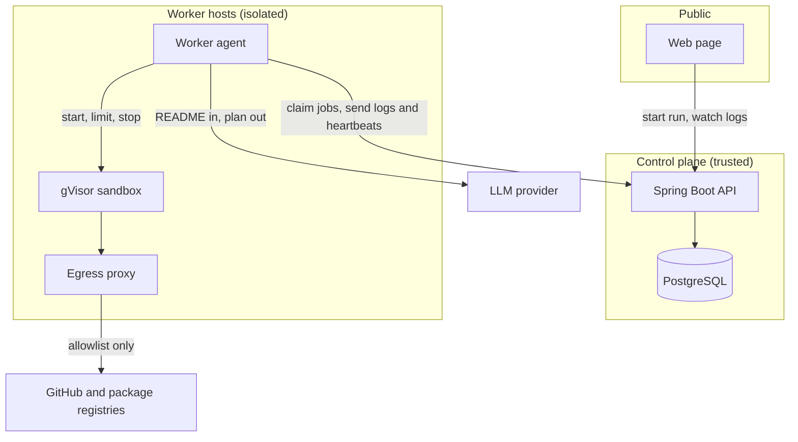
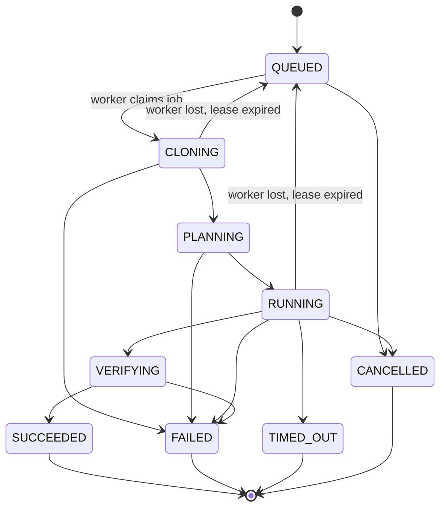

# Build plan

Last updated 2026-11-06. This is a plan, so nothing here is built yet. Limits and dates are starting targets, and the numbers marked `[TODO]` will be filled in from real measurements.

## Goal

Build a backend system that safely runs untrusted code from public repos, and prove it with published results.

**Finished means:**

- A stranger can paste a repo URL and watch a real run with live logs.
- Runs survive worker crashes without getting lost or stuck.
- The sandbox has been attacked on purpose, and the results are written up.
- A benchmark of 100 public repos is published with honest success and failure rates.
- It's deployed on AWS from Terraform, with CI on every PR.

## Scope

**In the first version**

- Public GitHub repos over HTTPS
- Single-service Node, Python and Java (Maven or Gradle) projects
- Live logs and a clear final result
- One simple web page to start a run and watch it
- No accounts. Abuse is limited by rate limits.

**Left out for now**

- Private repos and GitHub login
- Multi-service projects, or projects that need a database
- Repos that need their own Dockerfile or Docker Compose
- GPU workloads, desktop apps and mobile apps
- Projects that need paid API keys
- Billing

## Architecture

| Component | Job |
| --- | --- |
| API | Validates requests, stores runs, hands out jobs, streams logs, enforces rate limits |
| PostgreSQL | Holds runs, steps and logs, and also serves as the job queue |
| Worker agent | Claims a job, gets the plan, drives the sandbox, reports progress |
| Sandbox | Runs the repo's code. Thrown away after every run. |
| Egress proxy | Allows traffic only to GitHub and known package registries |

The most important boundary is that **the control plane never runs repo code**, and the sandbox never sees credentials.

## How a run moves

**A run only counts as a success if a check passes:** the project's tests exit with 0, or the app answers on its port. Commands finishing without an error isn't enough.

## Data model

| Table | Main fields |
| --- | --- |
| `run` | `id`, `repo_url`, `commit_sha`, `status`, `failure_reason`, `attempt`, `worker_id`, `lease_expires_at`, `created_at`, `finished_at` |
| `run_step` | `id`, `run_id`, `position`, `command`, `purpose`, `status`, `exit_code`, `started_at`, `finished_at` |
| `run_log` | `run_id`, `sequence`, `stream`, `content`, `created_at` |
| `worker` | `id`, `last_heartbeat_at`, `status` |

## API

| Method | Path | Purpose |
| --- | --- | --- |
| `POST` | `/api/runs` | Start a run from a repo URL |
| `GET` | `/api/runs/{id}` | Get status, steps and result |
| `GET` | `/api/runs/{id}/logs` | Stream logs with server-sent events |
| `POST` | `/api/runs/{id}/cancel` | Cancel a run |
| `POST` | `/internal/jobs/claim` | Worker claims the next job |
| `POST` | `/internal/runs/{id}/heartbeat` | Worker extends its lease |
| `POST` | `/internal/runs/{id}/logs` | Worker sends log chunks |
| `POST` | `/internal/runs/{id}/complete` | Worker reports the result |

Worker log chunks carry a sequence number, so a retry can't duplicate lines.

## Reliability

- **Claiming jobs:** workers use `SELECT ... FOR UPDATE SKIP LOCKED`, so two workers can't take the same job.
- **Leases:** a claimed job has a lease that the worker renews with heartbeats. If the worker dies, the lease expires.
- **Recovery:** a scheduled task puts expired runs back in the queue, up to a retry limit, then marks them failed.
- **Duplicate safety:** results from a worker that has lost its lease are rejected.
- **Backpressure:** a global limit caps running jobs, and new requests get a clear "busy" response when the queue is full.

## Sandbox and security

This is the core of the project. Assume every repo is hostile, and that every README is trying to trick the LLM.

| Threat | Defence |
| --- | --- |
| Escaping the container | gVisor runtime, non-root user, all Linux capabilities dropped, no Docker socket |
| Using up resources | Starting limits of 2 vCPU, 2 GB memory, 5 GB disk, 512 processes, 10 minutes |
| Crypto mining | Time and CPU limits, and no open internet |
| Attacking other sites | Egress proxy with an allowlist, and no inbound access |
| Stealing cloud credentials | Metadata service blocked, no IAM role that matters on worker hosts, no secrets in the sandbox |
| Reaching internal systems | Worker hosts in their own subnet, private IP ranges blocked |
| Prompt injection from a README | LLM output must match a strict schema, commands only ever run in the sandbox, and the LLM has no tools or credentials |
| Huge repos | Size checked through the GitHub API before cloning |
| Abuse of the service | Per-IP rate limits and a global daily run cap |
| Harmful content in logs | Log size limits, escaped output in the UI, logs deleted after 7 days |

Worker hosts are treated as disposable and replaced regularly. If an escape is ever suspected, hosts are destroyed rather than cleaned.

**Rule:** the service stays private until Milestone 2's attack tests pass.

## The AI step

The LLM gets the README, the file list and the detected project type. It returns JSON that lists each step's command and purpose, plus the check to run at the end.

- Output that doesn't match the schema is rejected.
- If a step fails, the LLM can see the end of the log and propose a fix, up to 2 times.
- The provider sits behind a Java interface, so it can be swapped.
- Every run stores its plan, which makes failures easy to study.

## Stack decisions

| Choice | Why | Rejected for now |
| --- | --- | --- |
| Java and Spring Boot | The stack this project is meant to prove | Python, which would be another AI wrapper |
| PostgreSQL as the queue | One system to run, and it easily handles this volume | Kafka and RabbitMQ, which add operations work without a real need |
| Server-sent events | Logs only flow one way, and it's simple | WebSockets |
| Docker with gVisor | Far stronger isolation than plain Docker, and it runs on normal EC2 | Plain Docker, which isn't a safe boundary for hostile code |
| Firecracker | Revisit later for even stronger isolation | It needs KVM support, so metal instances, which cost more |
| Two services (API and worker) | They have different trust levels, so the split is real | Microservices |
| EC2 and Terraform | Direct control over the host and network | Kubernetes, which is too much for this size |

Each rejected option is a good interview answer, so keep the reasoning up to date.

## Milestones

Target dates assume the work starts on 2026-11-09.

### Milestone 1: Core run loop (Nov 9 to Nov 22)

- [ ] Spring Boot project with Flyway, Docker Compose for local PostgreSQL, and CI
- [ ] `POST /api/runs`, `GET /api/runs/{id}`, with input validation
- [ ] Job queue with `SKIP LOCKED`
- [ ] Worker agent that claims jobs and runs a fixed command in a container
- [ ] Live logs over server-sent events
- [ ] Tests with Testcontainers

**Done when:** a Node repo with hardcoded setup steps can run from start to finish on a laptop, with live logs.

### Milestone 2: Safety and reliability (Nov 23 to Dec 6)

- [ ] gVisor runtime, resource limits, non-root user, dropped capabilities
- [ ] Egress proxy with an allowlist
- [ ] Leases, heartbeats, recovery and retry limits
- [ ] Cancel and timeouts
- [ ] Rate limits and concurrency caps
- [ ] Test repos that attack the sandbox: fork bomb, memory bomb, disk fill, network scan, metadata access
- [ ] Crash test: kill a worker in the middle of a run

**Done when:** every attack repo is stopped and logged, and killing a worker loses no runs.

### Milestone 3: AI setup planning (Dec 7 to Dec 20)

- [ ] Project type detection for Node, Python and Java
- [ ] LLM interface and schema-checked plans
- [ ] Verification step with tests or a port check
- [ ] Repair loop, limited to 2 retries
- [ ] Prompt injection test READMEs
- [ ] Clear failure reasons
- [ ] Simple web page

**Done when:** a real repo that it's never seen before runs from nothing but its URL, and a malicious README can't get past the sandbox.

### Milestone 4: Deploy and prove it (Dec 21 to Jan 3)

- [ ] Terraform for the network, EC2, RDS and worker hosts
- [ ] Metrics and dashboards for queue depth, run time and failures
- [ ] Load test
- [ ] 100-repo benchmark
- [ ] Architecture write-up, security write-up and demo video
- [ ] Public launch post

**Done when:** everything under "Finished means" is true.

## Testing

| Level | What it covers |
| --- | --- |
| Unit | State changes, plan validation, URL checks |
| Integration | API and queue on real PostgreSQL with Testcontainers |
| Concurrency | Many workers claiming jobs, with no job taken twice |
| Failure | Killed workers, expired leases, duplicate results |
| Security | A folder of attack repos that runs in CI where possible |
| Load | Queue and log streaming under many runs at once |

## Benchmark

Run a fixed list of 100 public repos, chosen before seeing any results, across all three languages. Publish the list and the raw outcomes, failures included.

| Metric | Result |
| --- | --- |
| Setup success rate | `[TODO: metric]` |
| Success rate by language | `[TODO: metric]` |
| Median and 95th percentile run time | `[TODO: metric]` |
| Most common failure reasons | `[TODO: metric]` |
| Sandbox overhead compared with plain Docker | `[TODO: metric]` |
| Peak runs handled at once | `[TODO: metric]` |
| Average cost per run | `[TODO: metric]` |

## Cost limits

Monthly budget: `[TODO: budget]`.

- Set an AWS budget alert before deploying anything.
- Start with one small worker host.
- Shut workers down when the project isn't being demoed.
- Cap LLM calls per run and runs per day.

## Risks

| Risk | Plan |
| --- | --- |
| The sandbox is hard to get right | Do it in Milestone 2, before any AI work, and stay private until it passes |
| Success rates are low | That's fine. Publish it and explain why, because failure analysis makes a good story. |
| The scope grows | Anything outside this plan goes in an issue for later |
| AWS costs surprise you | Budget alerts, caps and stopping workers when idle |
| The schedule slips | Milestones 1 and 2 matter most. Cut the web page and the load test before cutting safety. |

## After the first version

Only if the first version works and people care:

- Checking setup instructions automatically for open-source maintainers
- A GitHub Action that fails when a README's setup stops working
- More languages and multi-service projects
- Firecracker
